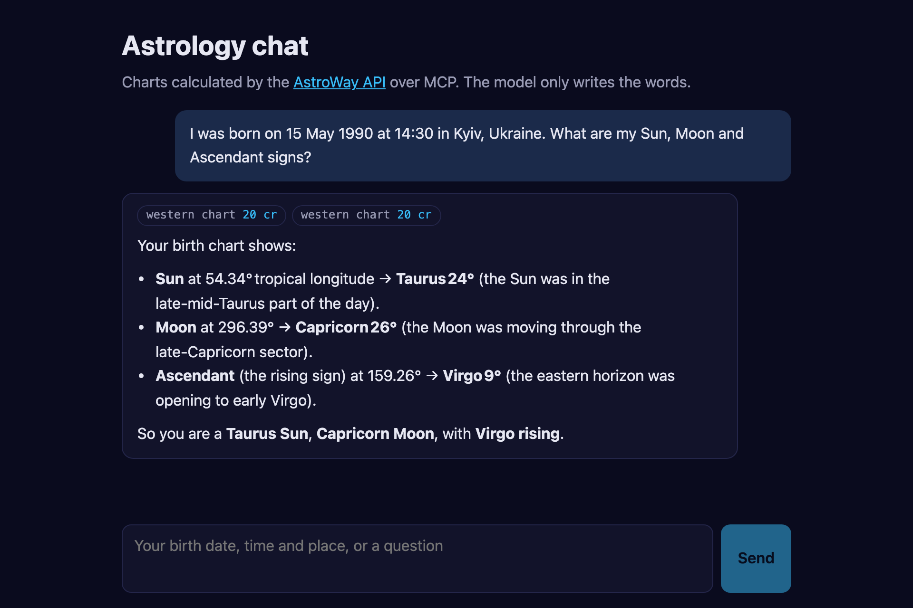

# Astrology chat

An AI astrology chatbot on the [AstroWay API](https://api.astroway.info). The model talks; every chart, position and date comes from a real calculation on the hosted MCP server at `https://mcp.astroway.info`. Bring any OpenAI-compatible model key and an AstroWay key, and it runs.

[](https://vercel.com/new/clone?repository-url=https%3A%2F%2Fgithub.com%2Fastroway%2Fstarter-astrology-chat&env=ASTROWAY_API_KEY,LLM_API_KEY&envDescription=An%20AstroWay%20key%20(free%20tier%2C%20no%20card)%20and%20a%20key%20for%20any%20OpenAI-compatible%20model&envLink=https%3A%2F%2Fgithub.com%2Fastroway%2Fstarter-astrology-chat%23environment&project-name=astrology-chat&repository-name=astrology-chat)



The chips above the answer are the AstroWay calls the model made in that turn and what each one cost.

## Run it

```bash
git clone https://github.com/astroway/starter-astrology-chat && cd starter-astrology-chat
npm install && cp .env.example .env.local   # put both keys in .env.local
npm run dev                                  # http://localhost:3000
```

Get an AstroWay key at [api.astroway.info/dashboard/sign-up](https://api.astroway.info/dashboard/sign-up). The free tier is 10,000 credits a month and needs no card. An `aw_test_*` sandbox key spends nothing while you build.

## Environment

| Variable | Required | What it is |
|---|---|---|
| `ASTROWAY_API_KEY` | yes | Your AstroWay key. Sent to the MCP server as `Authorization: Bearer`, never to the browser. |
| `LLM_API_KEY` | yes | A key for the model provider. |
| `LLM_BASE_URL` | no | Any OpenAI-compatible endpoint. Default `https://api.openai.com/v1`. Groq, OpenRouter, Together, Mistral and a local Ollama all work. |
| `LLM_MODEL` | no | Default `gpt-4o-mini`. The model must support tool calling. |
| `ASTROWAY_MCP_URL` | no | Default `https://mcp.astroway.info/mcp/core`. Point it at another subject, e.g. `/mcp/vedic` or `/mcp/tarot`. The list is at [mcp.astroway.info/domains](https://mcp.astroway.info/domains). |
| `ASTROWAY_TOOLS` | no | Comma-separated tool names the model may use, or `*` for every tool on that server. See below. |
| `RATE_LIMIT_PER_HOUR` | no | Messages per hour per visitor address. Default 20, `0` turns it off. |

## What it calls

One server route, `app/api/chat/route.ts`, does the whole job:

1. Connects to the AstroWay MCP server over Streamable HTTP with your key.
2. Lists the tools and keeps the ones in `ASTROWAY_TOOLS`.
3. Sends the conversation and those tools to your model.
4. Runs every tool call the model asks for on the MCP server and hands the result back, up to five rounds.
5. Returns the answer and the list of calls with their price in credits.

By default the model sees six tools from the `core` server:

| Tool | What it calls | Credits |
|---|---|---|
| `astroway_western_chart` | `POST /v1/chart` | 20 |
| `astroway_western_planets` | `POST /v1/planets` | 10 |
| `astroway_calendar_moon_phase` | `POST /v1/moon-phase` | 10 |
| `astroway_calendar_retrograde_periods` | `POST /v1/retrograde-periods` | 50 |
| `astroway_horoscope_daily` | `POST /v1/horoscope/daily` | 50 |
| `astroway_cost_estimate` | prices a plan of calls from the public price list, without running them | 0 |

The price of every tool is the last line of its description (`[Cost: 20 credits (Tier 2)]`), which is where the app reads it from, so the chips stay right when prices change. The full list is on the [credits page](https://api.astroway.info/en/credits/).

**Why only six.** The `core` server lists about a hundred tools and the whole catalogue several hundred. A model reads every tool it is given on every request, so a long list costs tokens on each turn and makes the choice worse. Add what your app needs to `ASTROWAY_TOOLS`; use `*` only with a model that has room for it.

## Things worth keeping when you rewrite it

- **The keys live on the server.** The browser talks to `/api/chat` only. Nothing in this app is prefixed `NEXT_PUBLIC_`, because anything with that prefix ships to the browser.
- **The system prompt asks for birth data instead of guessing it** (`lib/prompt.ts`). A chart without a birth time still has planets but no houses or Ascendant, and a guessed time moves them without any error.
- **Time zones go as IANA names.** `Europe/Kyiv` in May 1990 was UTC+4, not the +2 or +3 a model would guess today. The API looks the offset up for the date.
- **Results are asked for small.** The prompt tells the model to pass `fields` and `precision`. A full natal chart is about 90 KB; the paths a chat needs are under 2 KB. Same credits, far fewer model tokens.
- **A public deploy spends your credits.** Every visitor's message can trigger paid calls, so there is a per-address limit in front of the route. It lives in memory, per server instance: good for a demo, and worth replacing with a shared store before you put it in front of real traffic. Watch the balance on the [dashboard](https://api.astroway.info/dashboard/).
- **Free model tiers cap tokens per minute.** One turn is two or three model requests. The app waits out a short `429` (up to 20 seconds) and returns a longer one as an error with the provider's own message.

## Where to go next

- [Agent setup](https://api.astroway.info/en/agent-setup/): the same MCP servers in Claude, Cursor, VS Code and the rest.
- [AstroWay plugin for Claude Code and Cursor](https://github.com/astroway/agent-plugin): teaches a coding agent the rules this app follows.
- [Human Design starter](https://github.com/astroway/starter-human-design) and [BaZi starter](https://github.com/astroway/starter-bazi): the REST API without a model.

## Licence

MIT. Take it apart.
